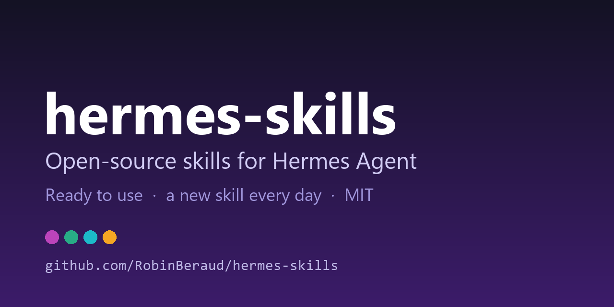
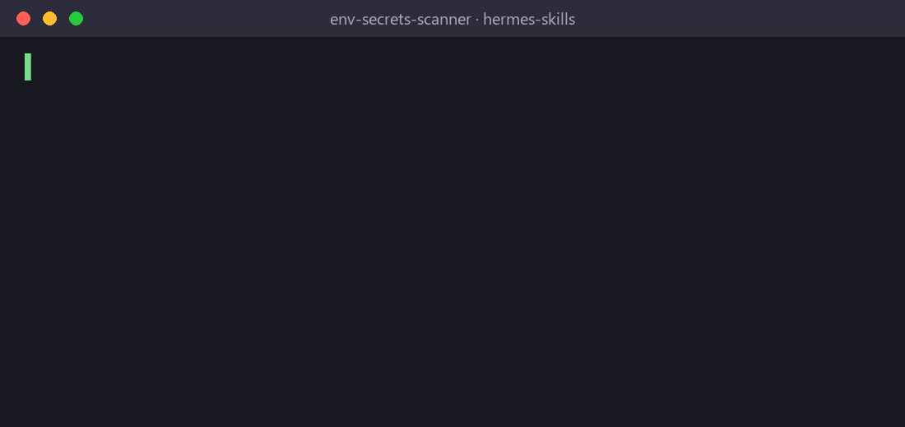

<p align="center"></p>

<p align="center">
  <h1 align="center">hermes-skills</h1>
  <p align="center">Open-source skills library for <a href="https://github.com/NousResearch/hermes-agent">Hermes AI Agent</a> — plug-and-play integrations for finance, web, marketing and more.</p>
</p>

<p align="center">
  <a href="https://github.com/RobinBeraud/hermes-skills/stargazers"></a>
  <a href="https://dev.to/robinberaud"></a>
  
  
</p>

---

## See it in action

<p align="center"></p>

## Install a skill (one command)

Hermes can install any skill straight from this repo, with a security scan and a confirmation prompt:

```bash
hermes skills inspect RobinBeraud/hermes-skills/security/env-secrets-scanner   # preview, installs nothing
hermes skills install RobinBeraud/hermes-skills/security/env-secrets-scanner   # install
```

Replace the path with any skill folder listed below (`<category>/<skill>`).

## What are Hermes Skills?

Skills are Markdown files that give Hermes contextual knowledge and reusable code patterns to interact with external services. Drop a `SKILL.md` into `~/.hermes/skills/` and your agent knows how to use the service.

## Available Skills

### 🆕 Latest additions
| Skill | Description | Added |
|-------|-------------|-------|
<!-- LATEST -->
| [short-video-script](content-creation/short-video-script/SKILL.md) | Write a short-form video script (Reel, TikTok, YouTube Short) with a hook, tension, payoff, call to action, shot notes and caption chunks, t | 2026-11-12 |
| [hook-lab](content-creation/hook-lab/SKILL.md) | Generate 10 hooks for a post or video, then score them on explicit criteria (specificity, curiosity, promise kept) and flag over-promising.  | 2026-11-11 |
| [content-repurposer](content-creation/content-repurposer/SKILL.md) | Turns one article, transcribed video or podcast into several formats (LinkedIn post, carousel, thread, newsletter blurb, short-video script) | 2026-11-10 |
| [dependency-update-watch](software-development/dependency-update-watch/SKILL.md) | Check a requirements.txt or package.json against PyPI and the npm registry and report which pinned dependencies have major, minor or patch u | 2026-11-09 |
| [docker-compose-auditor](devops/docker-compose-auditor/SKILL.md) | Audit a docker-compose.yml for exposed databases, inline secrets, privileged containers, unpinned images, missing restart policies and healt | 2026-11-08 |
| [server-health-report](devops/server-health-report/SKILL.md) | Produce a read-only health report for a Linux server (disk, inodes, memory, swap, load, failed systemd units, pending updates, reboot flag)  | 2026-11-07 |
| [backup-verifier](devops/backup-verifier/SKILL.md) | Check that a backup file exists, is recent, is not suspiciously small, and actually decompresses, using one dependency-free Python script. U | 2026-11-06 |
| [seo-page-audit](seo/seo-page-audit/SKILL.md) | Audit the on-page SEO of a single URL or local HTML file (title, meta description, headings, canonical, images, links, content length) and g | 2026-11-05 |
| [readme-auditor](software-development/readme-auditor/SKILL.md) | Audit a README.md with a local script (title, intro, install, usage, code blocks, license, links) and get a 0-100 score plus prioritized fix | 2026-11-04 |
| [csv-quick-insights](data-analysis/csv-quick-insights/SKILL.md) | Profile an unfamiliar CSV in seconds with a stdlib-only Python script: column types, missing values, duplicates, numeric outliers, top categ | 2026-11-03 |
| [changelog-from-git](software-development/changelog-from-git/SKILL.md) | Generate a readable, grouped Markdown changelog from git history (Conventional Commits aware, PR numbers kept) between two refs; use when pr | 2026-11-02 |
| [sitemap-link-checker](web/sitemap-link-checker/SKILL.md) | Check a website for broken pages and dead outgoing links starting from its sitemap.xml, using one stdlib Python script; use it before a laun | 2026-11-01 |
| [flip-margin-calculator](finance/flip-margin-calculator/SKILL.md) | Compute the projected profit, margins, ROI, break-even resale price and sensitivity table of a buy-renovate-resell property deal from editab | 2026-10-31 |
| [invoice-to-ledger-csv](productivity/invoice-to-ledger-csv/SKILL.md) | Extract supplier, date, net, VAT, gross and a suggested category from invoice text or PDF files into an accounting-ready CSV, with total-con | 2026-10-30 |
| [real-estate-regulation-watch](research/real-estate-regulation-watch/SKILL.md) | Weekly watch on housing regulation news and French mortgage rates, built from public RSS feeds and the ECB open data API, with a source link | 2026-10-29 |
| [area-market-analysis](data-analysis/area-market-analysis/SKILL.md) | Analyse the residential property market of a French commune from open DVF sales data (volumes, median price per m2, apartments vs houses, tr | 2026-10-28 |
| [listing-alert-triage](automation/listing-alert-triage/SKILL.md) | Parse real-estate listing alert e-mails (plain text, HTML or .eml), extract price, surface and city, compute price per m2, compare it to ref | 2026-10-27 |
| [env-secrets-scanner](security/env-secrets-scanner/SKILL.md) | Scan a project folder or git-staged files for leaked secrets (.env files, API keys, private keys, passwords in URLs) before committing, with | 2026-10-26 |


### 🤖 AI Workforce (new: 20 agent roles)
Twenty roles for your Hermes agent, each with documented use cases and, for 13 of them, a tested stdlib script. See [ai-workforce/](ai-workforce/README.md).

| Role | What it does |
|------|--------------|
| [Idea Generator](ai-workforce/idea-generator/SKILL.md) · [Design Prototyper](ai-workforce/design-prototyper/SKILL.md) · [Product Critic](ai-workforce/product-critic/SKILL.md) | Brainstorm, prototype and critique |
| [Content Creator](ai-workforce/content-creator/SKILL.md) · [Content Transformer](ai-workforce/content-transformer/SKILL.md) · [Content Guardian](ai-workforce/content-guardian/SKILL.md) | Write, repurpose and screen content |
| [Data Visualizer](ai-workforce/data-visualizer/SKILL.md) · [Data Synthesizer](ai-workforce/data-synthesizer/SKILL.md) · [Data Forecaster](ai-workforce/data-forecaster/SKILL.md) | Chart, generate and forecast data |
| [Research Assistant](ai-workforce/research-assistant/SKILL.md) · [Trend Watcher](ai-workforce/trend-watcher/SKILL.md) · [Decision Optimizer](ai-workforce/decision-optimizer/SKILL.md) | Find evidence, spot trends, decide |
| [Anomaly Detector](ai-workforce/anomaly-detector/SKILL.md) · [Digital Twin](ai-workforce/digital-twin/SKILL.md) · [Digital Simulation](ai-workforce/digital-simulation/SKILL.md) · [Workflow Automaton](ai-workforce/workflow-automaton/SKILL.md) | Watch systems, simulate, automate |
| [Interactive Companion](ai-workforce/interactive-companion/SKILL.md) · [Journey Personalizer](ai-workforce/journey-personalizer/SKILL.md) · [Engagement Assessor](ai-workforce/engagement-assessor/SKILL.md) · [Engagement Booster](ai-workforce/engagement-booster/SKILL.md) | Guide, personalise and engage people |

### 🔬 Research
| Skill | Description | Requires |
|-------|-------------|----------|
| [Data Intelligence Router](research/data-intelligence-router/SKILL.md) | Route research questions to open APIs (OpenAlex, Crossref, arXiv, World Bank, ECB, NVD, Wikipedia...) through one keyless adapter with normalized JSON and provenance | — |

### 🎨 Media
| Skill | Description | Requires |
|-------|-------------|----------|
| [Note Visual](media/note-visual/SKILL.md) | Hand-drawn style diagrams (compare, 2x2 matrix, funnel, steps) as PNG for Substack Notes / LinkedIn posts, exact text, no image model | Pillow |

### 💹 Finance
| Skill | Description | Requires |
|-------|-------------|----------|
| [FMP](finance/fmp/SKILL.md) | Real-time stock quotes, company fundamentals, income statements, ratios, screener, crypto & forex via Financial Modeling Prep | `FMP_API_KEY` |

### 🌐 Web
| Skill | Description | Requires |
|-------|-------------|----------|
| [Firecrawl](web/firecrawl/SKILL.md) | Scrape any URL to clean Markdown, web search, full-site crawl, dynamic page interaction (clicks/forms), structured JSON extraction | `FIRECRAWL_API_KEY` |

### 📱 WhatsApp
| Skill | Description | Requires |
|-------|-------------|----------|
| [WBizTool](whatsapp/wbiztool/SKILL.md) | Contact lookup and management — find a number by name, identify unknown numbers, stats by country | WhatsApp bridge running |

### 🔍 SEO
| Skill | Description | Requires |
|-------|-------------|----------|
| [NeuronWriter](seo/neuronwriter/SKILL.md) | Content analysis and optimization via NeuronWriter API | `NEURONWRITER_API_KEY` |

### 🌐 WordPress
| Skill | Description | Requires |
|-------|-------------|----------|
| [WPBakery](wordpress/wpbakery/SKILL.md) | Build WordPress pages with WPBakery shortcodes and REST API | WordPress credentials |

### 📢 Marketing
| Skill | Description | Requires |
|-------|-------------|----------|
| [Hermes Tweet](marketing/hermes-tweet/SKILL.md) | Search X/Twitter, read replies, monitor accounts, export followers, and gate approved X actions through the native Hermes Tweet plugin | `XQUIK_API_KEY` |
| [Waitlister](marketing/waitlister/SKILL.md) | Manage waitlists via Waitlister.me API | `WAITLISTER_API_KEY` |

## Quick Start

```bash
# Copy a skill to your Hermes installation
cp -r finance/fmp ~/.hermes/skills/finance/

# Add required env vars
echo "FMP_API_KEY=your_key_here" >> ~/.hermes/.env

# Restart Hermes gateway
hermes gateway restart
```

Then ask Hermes naturally:
- *"What's the current price of Apple stock?"*
- *"Scrape https://example.com and summarize it"*
- *"What's the number of [contact name]?"*

## Contributing

PRs welcome! Skills should:
- Use environment variables for all credentials (never hardcode keys)
- Include working Python code examples
- Follow the SKILL.md format (see any existing skill)

## Auto-publishing

New skills are automatically published as Dev.to articles via GitHub Actions on each push. Follow [dev.to/YOUR_DEVTO](https://dev.to/YOUR_DEVTO) for updates.

## License

MIT
