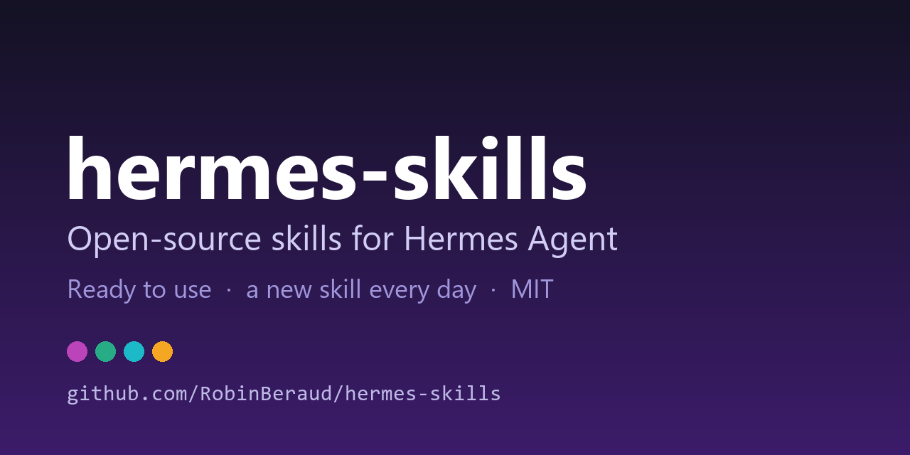
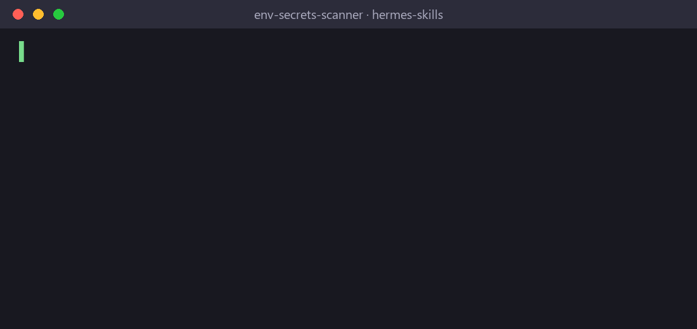

<p align="center"></p>

<p align="center">
  <h1 align="center">hermes-skills</h1>
  <p align="center">Open-source skills library for <a href="https://github.com/NousResearch/hermes-agent">Hermes AI Agent</a> — plug-and-play integrations for finance, web, marketing and more.</p>
</p>

<p align="center">
  <a href="https://github.com/RobinBeraud/hermes-skills/stargazers"></a>
  <a href="https://dev.to/robinberaud"></a>
  
  
</p>

---

## See it in action

<p align="center"></p>

## Install a skill (one command)

Hermes can install any skill straight from this repo, with a security scan and a confirmation prompt:

```bash
hermes skills inspect RobinBeraud/hermes-skills/security/env-secrets-scanner   # preview, installs nothing
hermes skills install RobinBeraud/hermes-skills/security/env-secrets-scanner   # install
```

Replace the path with any skill folder listed below (`<category>/<skill>`).

## What are Hermes Skills?

Skills are Markdown files that give Hermes contextual knowledge and reusable code patterns to interact with external services. Drop a `SKILL.md` into `~/.hermes/skills/` and your agent knows how to use the service.

## Available Skills

### 🆕 Latest additions
| Skill | Description | Added |
|-------|-------------|-------|
<!-- LATEST -->
| [real-estate-regulation-watch](research/real-estate-regulation-watch/SKILL.md) | Weekly watch on housing regulation news and French mortgage rates, built from public RSS feeds and the ECB open data API, with a source link | 2026-10-29 |
| [area-market-analysis](data-analysis/area-market-analysis/SKILL.md) | Analyse the residential property market of a French commune from open DVF sales data (volumes, median price per m2, apartments vs houses, tr | 2026-10-28 |
| [listing-alert-triage](automation/listing-alert-triage/SKILL.md) | Parse real-estate listing alert e-mails (plain text, HTML or .eml), extract price, surface and city, compute price per m2, compare it to ref | 2026-10-27 |
| [env-secrets-scanner](security/env-secrets-scanner/SKILL.md) | Scan a project folder or git-staged files for leaked secrets (.env files, API keys, private keys, passwords in URLs) before committing, with | 2026-10-26 |


### 🔬 Research
| Skill | Description | Requires |
|-------|-------------|----------|
| [Data Intelligence Router](research/data-intelligence-router/SKILL.md) | Route research questions to open APIs (OpenAlex, Crossref, arXiv, World Bank, ECB, NVD, Wikipedia...) through one keyless adapter with normalized JSON and provenance | — |

### 🎨 Media
| Skill | Description | Requires |
|-------|-------------|----------|
| [Note Visual](media/note-visual/SKILL.md) | Hand-drawn style diagrams (compare, 2x2 matrix, funnel, steps) as PNG for Substack Notes / LinkedIn posts, exact text, no image model | Pillow |

### 💹 Finance
| Skill | Description | Requires |
|-------|-------------|----------|
| [FMP](finance/fmp/SKILL.md) | Real-time stock quotes, company fundamentals, income statements, ratios, screener, crypto & forex via Financial Modeling Prep | `FMP_API_KEY` |

### 🌐 Web
| Skill | Description | Requires |
|-------|-------------|----------|
| [Firecrawl](web/firecrawl/SKILL.md) | Scrape any URL to clean Markdown, web search, full-site crawl, dynamic page interaction (clicks/forms), structured JSON extraction | `FIRECRAWL_API_KEY` |

### 📱 WhatsApp
| Skill | Description | Requires |
|-------|-------------|----------|
| [WBizTool](whatsapp/wbiztool/SKILL.md) | Contact lookup and management — find a number by name, identify unknown numbers, stats by country | WhatsApp bridge running |

### 🔍 SEO
| Skill | Description | Requires |
|-------|-------------|----------|
| [NeuronWriter](seo/neuronwriter/SKILL.md) | Content analysis and optimization via NeuronWriter API | `NEURONWRITER_API_KEY` |

### 🌐 WordPress
| Skill | Description | Requires |
|-------|-------------|----------|
| [WPBakery](wordpress/wpbakery/SKILL.md) | Build WordPress pages with WPBakery shortcodes and REST API | WordPress credentials |

### 📢 Marketing
| Skill | Description | Requires |
|-------|-------------|----------|
| [Hermes Tweet](marketing/hermes-tweet/SKILL.md) | Search X/Twitter, read replies, monitor accounts, export followers, and gate approved X actions through the native Hermes Tweet plugin | `XQUIK_API_KEY` |
| [Waitlister](marketing/waitlister/SKILL.md) | Manage waitlists via Waitlister.me API | `WAITLISTER_API_KEY` |

## Quick Start

```bash
# Copy a skill to your Hermes installation
cp -r finance/fmp ~/.hermes/skills/finance/

# Add required env vars
echo "FMP_API_KEY=your_key_here" >> ~/.hermes/.env

# Restart Hermes gateway
hermes gateway restart
```

Then ask Hermes naturally:
- *"What's the current price of Apple stock?"*
- *"Scrape https://example.com and summarize it"*
- *"What's the number of [contact name]?"*

## Contributing

PRs welcome! Skills should:
- Use environment variables for all credentials (never hardcode keys)
- Include working Python code examples
- Follow the SKILL.md format (see any existing skill)

## Auto-publishing

New skills are automatically published as Dev.to articles via GitHub Actions on each push. Follow [dev.to/YOUR_DEVTO](https://dev.to/YOUR_DEVTO) for updates.

## License

MIT
